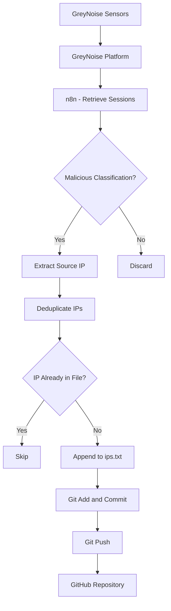

# BadIps

**An automated, continuously updated list of malicious IP addresses identified through GreyNoise sensor activity.**

BadIps is a lightweight threat intelligence project that collects malicious IP addresses observed by GreyNoise sensors and publishes them to a GitHub-hosted text file.

The entire process is automated using [n8n](https://n8n.io/), from retrieving sensor sessions to filtering, deduplication, and publishing updates to GitHub.

## Overview

GreyNoise operates a global network of sensors that observe internet scanning, exploitation attempts, and other potentially malicious activity.

BadIps uses session data collected by my own GreyNoise sensors to identify source IP addresses that GreyNoise has classified as **Malicious**.

These IP addresses are extracted, deduplicated, and added to a persistent text file. Changes are automatically committed and pushed to this repository using Git.

The result is a simple, publicly accessible list of IP addresses observed engaging in activity classified as malicious by GreyNoise.

## How It Works

The process is managed by a self-hosted n8n instance.



### 1. Session Collection

n8n retrieves session data from the GreyNoise API associated with my deployed sensors.

These sessions represent activity observed by the sensors, including connections originating from internet hosts.

### 2. Malicious Classification Filtering

Session data is filtered to retain only source IP addresses associated with the **Malicious** classification in GreyNoise.

Activity that does not meet this classification is excluded.

### 3. IP Extraction and Deduplication

The source IP address is extracted from each qualifying session.

Deduplication occurs in two stages:

- **Workflow deduplication:** Duplicate IP addresses are removed from the retrieved dataset within n8n.
- **Persistent deduplication:** Before an IP address is appended to the file, the existing list is checked to ensure that the address is not already present.

This prevents repeated observations of the same IP address from creating duplicate entries.

### 4. Local File Updates

New IP addresses are appended to `ips.txt`, a plain-text file stored in a local Git repository on the n8n host.

Each line contains a single IP address.

Example:

```text
192.0.2.10
198.51.100.25
203.0.113.42
```

*The addresses above are documentation examples, not actual malicious IPs.*

The list is cumulative. Previously recorded IP addresses remain in the file unless explicitly removed.

### 5. Automated GitHub Publishing

Once the file has been updated, n8n executes Git commands to publish the changes.

The process is equivalent to:

```bash
git add .
git commit -m "Update malicious IP list"
git push origin main
```

The repository is updated automatically without requiring manual intervention.

## Repository Structure

```text
BadIps/
├── README.md
└── ips.txt
```

| File | Description |
|---|---|
| `README.md` | Project documentation |
| `ips.txt` | Deduplicated list of malicious source IP addresses |

## Using the IP List

The IP list is provided as a plain-text file, making it straightforward to integrate into other systems.

Potential uses include:

- Firewall address groups and blocklists
- Intrusion detection and prevention systems
- SIEM enrichment and correlation
- Network monitoring and alerting
- Threat intelligence research
- Automated security workflows

To download the list:

```bash
curl -o ips.txt \
  https://raw.githubusercontent.com/USERNAME/BadIps/main/ips.txt
```

Replace `USERNAME` with the appropriate GitHub username or organisation.

## Technology Stack

| Component | Purpose |
|---|---|
| GreyNoise Sensors | Observe internet-originated activity |
| GreyNoise API | Provide session data and classifications |
| n8n | Orchestrate collection, filtering and publishing |
| Git | Track changes to the IP list |
| GitHub | Host and distribute the resulting list |

## Important Considerations

### Classification

All addresses in this repository originate from sessions associated with the GreyNoise **Malicious** classification.

Inclusion in the list does not independently establish that an IP address is currently malicious or that every connection originating from it is harmful.

### Historical Data

The list is cumulative and does not currently implement automatic expiration or removal of older entries.

An address may remain listed even after its behaviour or ownership has changed.

### Blocking Considerations

IP addresses can be reassigned, shared, or used by compromised systems.

**Use this list as a threat intelligence input rather than an authoritative, permanent blocklist.**

Review the implications before applying automated blocking, particularly in production environments.

### Coverage

This project only includes malicious activity observed by my own GreyNoise sensors and successfully retrieved through the GreyNoise API.

It is not intended to represent the complete GreyNoise threat intelligence dataset or a comprehensive list of malicious internet hosts.

## Automation

The collection and publication process is automated through n8n.

Updates depend on successful session retrieval, workflow execution, and GitHub connectivity.

The repository's commit history provides a record of changes to the published IP list.

## Disclaimer

This project is provided for informational, research, and defensive security purposes.

The IP addresses are derived from third-party threat intelligence classifications and observed sensor activity. No guarantee is made regarding their accuracy, completeness, or continued relevance.

Users are responsible for validating the data and determining its suitability for their own environments.

## Acknowledgements

This project uses sensor data and threat intelligence classifications provided by [GreyNoise](https://www.greynoise.io/).

Automation is powered by [n8n](https://n8n.io/).

BadIps is an independent project and is not affiliated with or officially endorsed by GreyNoise or n8n.
